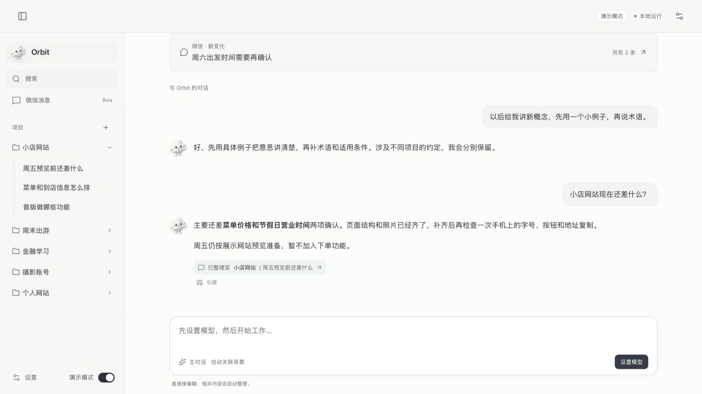
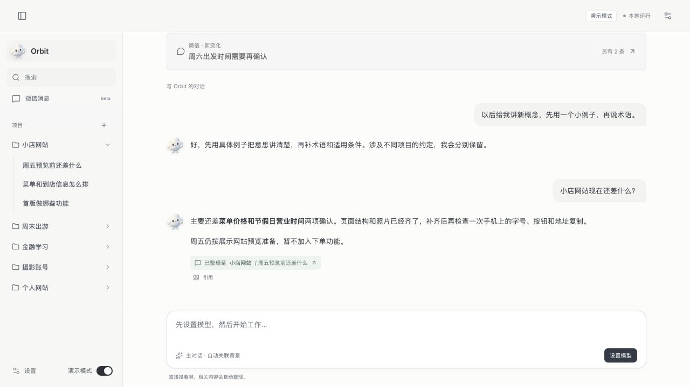
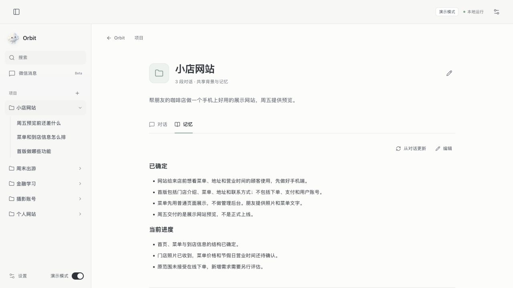
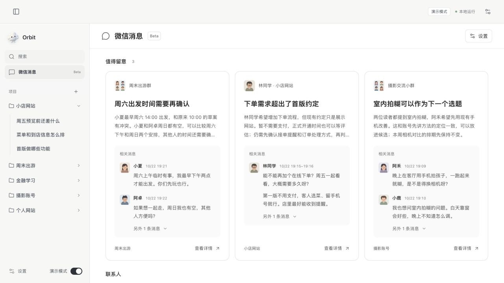

# Orbit

一个还在开发中的 Personal Agent 原型。主要想尝试两件事：把 IM 通知作为个人 Context 的来源，以及让 Agent 主动整理、管理不断积累的对话。



*由实际产品截图组成的界面预览，使用虚构的演示数据。*

## 为什么做这个东西

平时会和 Agent 讨论金融、硬件、软件工程等各种问题，也会同时推进几个开发项目。时间一长，对话里已经积累了很多背景、知识和决定，但找回这些内容、判断该在哪段对话里继续，仍然需要用户自己处理。

另一方面，很多新的个人 Context 来自微信等 IM：朋友调整行程、合作方补充需求、读者提出问题。这些信息如果能够被 Agent 理解，就有机会帮助用户继续推进手头的事情。

Orbit 想把这两部分连接起来。极端的 One Session 和越来越长的对话列表之间，应该还有一种更自然的交互方式。

## 两个比较有意思的尝试

### 1. 从系统通知获取 Context

通过只读查询 macOS 的系统通知数据库，增量获取微信通知，再整理成联系人概况和需要留意的信息。分析会附上原始消息片段，方便核对；也可以结合已有项目，发现行程冲突、需求变化或值得继续讨论的问题。

目前接通的是**微信**，飞书等其他 IM 尚未接入。这条路径比较轻便，但只能拿到系统保留的通知片段，可能截断或遗漏，不能代替完整聊天记录，也没有自动发微信的功能。

### 2. 让 Agent 主动收纳和管理对话

产品上有一个主 Bot，也保留独立对话。用户可以持续在主对话中交流，完整回答留在当前页面；主 Bot 将相关内容收纳到「项目 → 对话」，需要时再进入具体讨论。

后台整理开启后，会按变化更新摘要、标题和项目归属，并维护共享记忆。每个项目有自己的背景和约定，主 Bot 另有一份通用记忆。下次遇到相关主题时，Agent 可以找回这些背景继续处理，减少用户逐个整理和搜索对话的负担。

这里参考了话题式的组织方式，还在探索交互和 Context 如何更好地配合。后台机制见 [自动整理说明](docs/BACKGROUND-ORGANIZER.md)。

## 现在做到哪一步

- 已有可运行的 macOS 客户端：主对话、项目与多对话、Markdown 记忆、后台自动整理、微信通知读取与分析。
- 侧边栏底部有「演示模式」，包含虚构的项目、对话和消息分析，使用独立的数据空间。浏览预置内容无需 API Key；新对话和新分析仍需要模型。
- 当前以文字交互为主，使用 Electron、React、Pi SDK 和 DeepSeek；SQLite 保存记录，Markdown 保存可编辑的记忆。
- 仍是个人原型。分类和分析可能出错，人工调整会受到保护，自动归类支持查看记录和撤销。没有云同步或多人协作，也未做完整的跨平台验证。

<details>
<summary>查看产品截图</summary>

**主对话与自动收纳**



**项目共享记忆**



**微信消息与原始引用**



</details>

## 怎么运行

推荐在 macOS 上使用 Node.js 24 或更新版本（最低 22.19），并安装 Xcode Command Line Tools，供通知读取器编译使用。首次安装和桌面启动需要网络。

```sh
git clone https://github.com/scfdds/orbit-personal-agent.git
cd orbit-personal-agent
npm ci
npm run desktop:dev
```

打开后，可先开启侧边栏底部的「演示模式」查看预置内容。

要使用真实模型，在非演示模式下进入「设置 → 通用」，填写自己的 DeepSeek API Key；也可以复制 `.env.example` 为 `.env.local` 后填写。密钥不随源码提供。后台整理在「设置 → 自动整理」中开启，默认关闭。

真实微信采集需要另外开启，并在 macOS「隐私与安全性 → 完全磁盘访问」授权当前客户端。通知中心界面可以关闭，但 Mac、微信和采集程序需要运行，且微信确实产生系统通知。用于实际采集时，建议先按 [桌面构建说明](README-DESKTOP.md) 打包为固定位置的 `Orbit.app`，再授权。

也可以用浏览器进行界面开发：

```sh
npm run dev
```

访问 `http://127.0.0.1:5174`，本机后端运行在 `4330`。浏览器本身不能读取 macOS 通知；真实采集依赖本机后端、原生读取器和系统权限。

### 数据与权限

仓库里的对话、消息、联系人头像和展示截图均为演示素材，不包含个人聊天记录或 API Key。真实数据默认保存在本机：源码运行使用 `.agent-data/orbit/`，桌面客户端使用 `~/Library/Application Support/Orbit/`，这些目录不应提交到 Git。

通知解读会把已允许来源的消息片段发送给配置的模型。浏览内置演示不需要系统通知权限；应用不会自动开启真实采集或发送微信消息。系统通知数据库并非稳定的公开接口，macOS 更新可能需要适配。

## 代码与验证

```text
src/client/desktop/     桌面界面
src/server/             Agent、项目、记忆、后台整理、通知分析
src/shared/             共享类型和状态
src/apps/               内置应用原型
desktop/                Electron 桌面壳
scripts/native/         macOS 通知读取器
docs/                   机制说明和演示图片
```

```sh
npm run build
npm test
npm run desktop:test
```

这些检查无需个人 API Key。桌面构建、签名和权限细节见 [README-DESKTOP.md](README-DESKTOP.md)，主要依赖的许可说明见 [THIRD-PARTY-NOTICES.md](THIRD-PARTY-NOTICES.md)。
